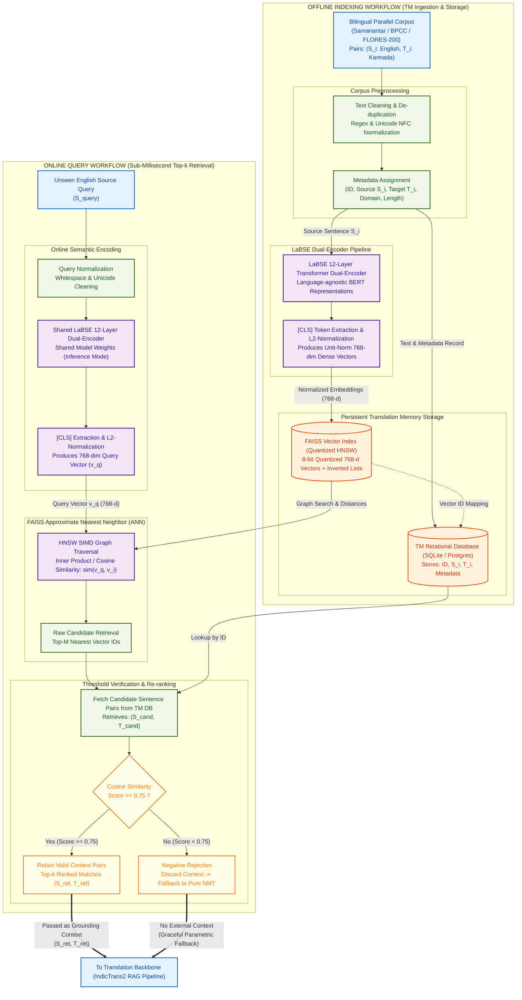

# System Architecture & Flow Diagrams
**Retrieval-Augmented Low-Resource Machine Translation (RAMT)**  
*Primary Language Pair: English → Kannada (`en → kn`)*

This document contains the end-to-end architectural flow diagrams for the two core sub-systems:
1. **Semantic Retrieval Module (LaBSE + FAISS)**: Offline indexing and online query workflows.
2. **Translation Backbone (IndicTrans2 with In-Context RAG)**: Input composition, script unification, Transformer core, and post-processing.

---

## Diagram 1: Semantic Retrieval Module (LaBSE + FAISS)



---

## Diagram 2: Translation Backbone (IndicTrans2 with In-Context RAG)

```mermaid
flowchart TD
    %% ===================================================
    %% LAYER 1: INPUT COMPOSITION
    %% ===================================================
    subgraph Layer1 ["LAYER 1: INPUT COMPOSITION & ENTITY TAGGING"]
        direction TB
        RAW_IN["English Query (S_query)\ne.g., 'Farmers protect crops from heavy rainfall in Karnataka.'"]
        RET_CTX["Retrieved TM Context (S_ret, T_ret)\nFrom Semantic Retrieval Module (Score >= 0.75)\ne.g., 'Farmers protect crops from pests.' -> 'ರೈತರು ಬೆಳೆಗಳನ್ನು ಕೀಟಗಳಿಂದ ರಕ್ಷಿಸುತ್ತಾರೆ.'"]
        
        ENTITY_TAG["Entity Preservation Parser\nEncloses numbers, dates, formulas & URLs in <dnt> ... </dnt>"]
        
        FORMAT_PROMPT["Formatted In-Context String Composition:\n[CONTEXT_SRC] <S_ret> [CONTEXT_TGT] <T_ret> [INPUT_SRC] <S_query>"]
        
        RAW_IN --> ENTITY_TAG
        RET_CTX --> ENTITY_TAG
        ENTITY_TAG --> FORMAT_PROMPT
    end

    %% ===================================================
    %% LAYER 2: PREPROCESSING & SCRIPT UNIFICATION
    %% ===================================================
    subgraph Layer2 ["LAYER 2: PREPROCESSING & SCRIPT UNIFICATION"]
        direction TB
        INDIC_NLP["IndicNLP Preprocessing & Script Unification\n* Normalization: Unicode NFC normalization & punctuation fix\n* Script Mapping: Rule-based transliteration of Kannada text -> Unified Devanagari script\n(Shares subwords across Indic scripts to leverage multilingual transfer)"]
        
        TOKENIZER["SentencePiece Subword Tokenizer\n* Byte-Pair Encoding (BPE)\n* Indic Shared Vocabulary: 128,000 subwords\n* English Vocabulary: 32,000 subwords\n* Prepends target language tag: '__kan_Knda__'"]
        
        FORMAT_PROMPT --> INDIC_NLP --> TOKENIZER
    end

    %% ===================================================
    %% LAYER 3: TRANSFORMER CORE (IndicTrans2 Distilled 200M)
    %% ===================================================
    subgraph Layer3 ["LAYER 3: GENERATIVE TRANSFORMER CORE (IndicTrans2 Architecture)"]
        direction TB
        
        EMBED_IN["Input Token Embeddings + Positional Encodings\nEmbedding Dimension: d_model = 1024"]
        
        subgraph Encoder_Stack ["18-Layer Transformer Encoder"]
            ENC_LAYER["18 Encoder Layers (Deep & Thin Architecture)\n* 16 Multi-Head Self-Attention Heads\n* Feed-Forward Dimension: d_ff = 4096\n* Attends simultaneously to Context tokens & Query tokens\n* Pre-Layer Normalization (Pre-LN)"]
        end
        
        subgraph Decoder_Stack ["18-Layer Transformer Decoder"]
            DEC_SELF["Masked Multi-Head Self-Attention (16 Heads)\nAutoregressive causal token masking"]
            DEC_CROSS["Encoder-Decoder Multi-Head Cross-Attention (16 Heads)\nDirectly conditions on contextual representations & query"]
            DEC_FFN["Feed-Forward Networks with GELU Non-Linearity\nPre-LN residual connections + Dropout = 0.1"]
            DEC_SELF --> DEC_CROSS --> DEC_FFN
        end
        
        subgraph PEFT_LoRA ["Parameter-Efficient Adaptation (LoRA)"]
            LORA_NOTE["Low-Rank Adaptation (LoRA) Adapters\nr = 16, alpha = 32 applied to Query/Key/Value projections\n(Freezes base weights; trains <0.4% parameters to condition on TM context)"]
        end
        
        TOKENIZER --> EMBED_IN --> ENC_LAYER
        ENC_LAYER -->|"Contextual Memory Keys & Values"| DEC_CROSS
        DEC_FFN -.->|"Adapted via"| LORA_NOTE
    end

    %% ===================================================
    %% LAYER 4: POST-PROCESSING & GENERATION
    %% ===================================================
    subgraph Layer4 ["LAYER 4: POST-PROCESSING & SCRIPT RESTORATION"]
        direction TB
        
        BEAM_SEARCH["Autoregressive Beam Search Decoding\nBeam Size = 5, Length Penalty alpha = 1.0\nGenerates target sequence tokens"]
        
        DEV_OUT["Unified Devanagari Output Generation\nIntermediate representation output from vocabulary"]
        
        DETRANS["Deterministic Reverse Script Mapping (IndicNLP)\nTransliterates Unified Devanagari -> Native Kannada Script (kan_Knda)"]
        
        DETOK["Detokenization & Entity Restoration\n* Strips BPE subword markers (' ')\n* Resolves <dnt> tags to restore exact numbers/dates/entities"]
        
        FINAL_OUT["Final Verified Kannada Translation Output\ne.g., 'ರೈತರು ಕರ್ನಾಟಕದಲ್ಲಿ ಭಾರಿ ಮಳೆಯಿಂದ ಬೆಳೆಗಳನ್ನು ರಕ್ಷಿಸುತ್ತಾರೆ.'"]
        
        DEC_FFN --> BEAM_SEARCH --> DEV_OUT --> DETRANS --> DETOK --> FINAL_OUT
    end

    %% Styles
    classDef l1 fill:#e8eaf6,stroke:#3f51b5,stroke-width:2px,color:#1a237e;
    classDef l2 fill:#e0f2f1,stroke:#00796b,stroke-width:2px,color:#004d40;
    classDef l3 fill:#f3e5f5,stroke:#7b1fa2,stroke-width:2px,color:#4a148c;
    classDef l4 fill:#e8f5e9,stroke:#388e3c,stroke-width:2px,color:#1b5e20;
    classDef lora fill:#fff8e1,stroke:#ffa000,stroke-width:2px,color:#ff6f00;

    class RAW_IN,RET_CTX,ENTITY_TAG,FORMAT_PROMPT l1;
    class INDIC_NLP,TOKENIZER l2;
    class EMBED_IN,ENC_LAYER,DEC_SELF,DEC_CROSS,DEC_FFN l3;
    class LORA_NOTE lora;
    class BEAM_SEARCH,DEV_OUT,DETRANS,DETOK,FINAL_OUT l4;
```



---

## Detailed Data-Flow Walkthrough

### 1. Retrieval Module Data Lifecycle
```text
[Offline Phase]
  Parallel Corpora (en, kn) 
       ──> Preprocessing & Deduplication 
       ──> LaBSE Dual-Encoder (768-d) 
       ──> L2-Normalization 
       ──> FAISS Quantized HNSW Index (vectors) + SQLite DB (text metadata)

[Online Phase]
  S_query (English) 
       ──> LaBSE Encoder (768-d unit vector) 
       ──> FAISS SIMD Inner Product Search 
       ──> Top candidates retrieved 
       ──> Cosine Threshold Check (>= 0.75)
             ├── Passed: Top-k (S_ret, T_ret) supplied to prompt
             └── Failed: Context dropped (Negative Rejection, avoids CAR degradation)
```

### 2. Generative Backbone Data Lifecycle
```text
  Inputs: (S_query) + Context: (S_ret, T_ret)
       ──> Entity Preservation (<dnt>...</dnt> wrapping)
       ──> Prompt Concatenation: [CONTEXT_SRC] <S_ret> [CONTEXT_TGT] <T_ret> [INPUT_SRC] <S_query>
       ──> Script Unification: Kannada text in T_ret converted to Unified Devanagari
       ──> SentencePiece Tokenization (128k Indic / 32k English vocab with language tag '__kan_Knda__')
       ──> IndicTrans2 18-Layer Encoder (Cross-attends across context + query tokens)
       ──> IndicTrans2 18-Layer Decoder (Adapted via LoRA r=16, alpha=32)
       ──> Autoregressive Beam Search generation in Unified Devanagari
       ──> Deterministic Script Mapping (Devanagari ──> Native Kannada script)
       ──> Entity Tag Unwrapping (<dnt>) and Detokenization
       ──> Final High-Fidelity Kannada Translation Output
```
